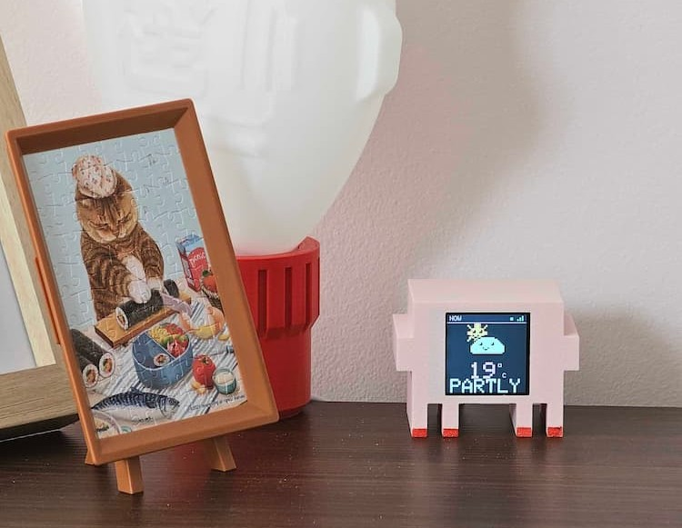
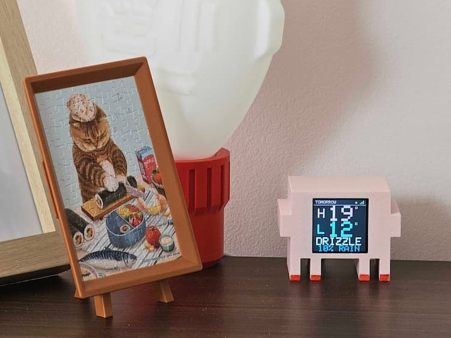

# Mochi Sky

A cute 8-bit weather screen for an ESP32 and a 1.54" ST7789 display. It shows the current weather and tomorrow's forecast, with animated pixel-art scenes (sun, moon, clouds, rain, snow, fog, storms) and a little face on every character.

No API key, no Home Assistant, no cloud account. Weather data comes from [Open-Meteo](https://open-meteo.com/) directly over WiFi.

## On the desk

<p align="center">
   
   
</p>
<p align="center"><em>NOW</em> and <em>TOMORROW</em> screens</p>

```
platformio.ini
images/
├── mochi-now.jpg
└── mochi-tomorrow.jpg
weather_mochi/
└── weather_mochi.ino
```

## Readable at 3 m

A 240x240 screen is only about 27 mm wide. At 3 metres there is no way to fit both today and tomorrow as small text and still read it, so the display alternates between **two full-screen pages** every 10 seconds:

| Page | Big elements | What else |
| --- | --- | --- |
| **NOW** | 120x120 animated icon, 49 px temperature | 42 px condition word, small unit |
| **TOMORROW** | 70 px high and low temperatures, 42 px `H` / `L` labels | 35 px condition word, 28 px rain chance |

For scale, at 3 metres the NOW temperature is about **6 arcminutes**, tomorrow's 70 px numbers about **9**, and the condition words about **5**. The page label and WiFi bars in the header are close-up details; the numbers, `H`/`L`, and condition are what you read from across the room.

The page switch is intentional. If you want both days on screen at once, you will have to make the numbers much smaller.

## What it shows

- **NOW:** huge current temperature, one big condition word (`CLEAR`, `PARTLY`, `RAIN`, etc.), and a large animated scene.
- **TOMORROW:** huge high/low temperatures, marked with a yellow `H` and a cyan `L`, tomorrow's condition, and rain chance.
- **Header:** `NOW` or `TOMORROW`, WiFi signal bars, and a status dot:
  - green = fresh data
  - orange = updating or stale
  - red = WiFi offline
- Refreshes every 15 minutes. If a refresh fails, it keeps the old data, turns the dot orange, and retries after 2 minutes.
- Page rotation: 10 seconds per page. Change `PAGE_SECONDS` in the config.

Day/night and the animation type come from the WMO weather code in the API. The background is a dark palette with light pink accents, a chunky 5x7 pixel font and hand-drawn sprites.

## Wiring

Same wiring as [clawd-mochi](https://github.com/yousifamanuel/clawd-mochi). Connect **VCC to 3.3V only** — not 5V.

| Display pin | ESP32 pin | Notes |
| --- | --- | --- |
| VCC | 3V3 | 3.3V only |
| GND | GND | |
| SDA / MOSI | GPIO 10 | hardware SPI |
| SCL / SCK | GPIO 8 | hardware SPI |
| RES | GPIO 2 | |
| DC | GPIO 1 | |
| CS | GPIO 4 | |
| BL | GPIO 3 | backlight, driven high |

The sketch uses a 240x240 ST7789. If your module is a 240x320 panel, change `tft.init(240, 240)` to `tft.init(240, 320)` and adjust the layout; the current UI assumes a square screen.

## Libraries

PlatformIO installs these automatically from `platformio.ini`. For the Arduino IDE, install them from the Library Manager:

- **Adafruit GFX Library**
- **Adafruit ST7735 and ST7789 Library**
- **ArduinoJson 7.x** (the sketch refuses to build with ArduinoJson 6)

Tested with ESP32 Arduino core **3.3.12**, Adafruit GFX **1.13.0**, ST7789 **1.12.0**, and ArduinoJson **7.4.3**.

## Configure

Open `weather_mochi/weather_mochi.ino` and edit the config block near the top:

```cpp
#define WIFI_SSID     "YOUR_WIFI_NAME"
#define WIFI_PASSWORD "YOUR_WIFI_PASSWORD"

// Right-click your spot in Google Maps, or use latlong.net
#define LATITUDE      51.5074
#define LONGITUDE     -0.1278
#define FAHRENHEIT    0                 // 1 = °F, 0 = °C

#define REFRESH_MINUTES 15
#define PAGE_SECONDS    10             // how long each of the two big pages stays up
```

Latitude/longitude decide the location. The API uses `timezone=auto`, so no timezone setting is needed. There is deliberately no place-name text; it would be unreadable at 3 metres.

### Pin changes

Pins are defined next to the config:

```cpp
#define TFT_SCK   8
#define TFT_MOSI  10
#define TFT_CS    4
#define TFT_DC    1
#define TFT_RST   2
#define TFT_BL    3
```

The sketch calls `SPI.begin(TFT_SCK, -1, TFT_MOSI, TFT_CS)` and uses the hardware SPI constructor, so these pins are remapped at runtime.

## Flash with PlatformIO

The repo root has a `platformio.ini` that points at `weather_mochi/` as the source directory, so nothing has to be moved.

1. Install PlatformIO:
   - **VS Code:** install the **PlatformIO IDE** extension, then open this repo folder.
   - **CLI:** `pip install platformio` (or `pipx install platformio`).
2. Plug in the board over USB.
3. Build and flash:

   ```bash
   pio run -t upload
   ```

   In VS Code, use the **Upload** button (arrow) in the PlatformIO toolbar.
4. Watch the logs (optional):

   ```bash
   pio device monitor
   ```

The env is `esp32-c3` (`board = esp32-c3-devkitm-1`, serial over native USB). For a different board, change `board` in `platformio.ini`; for a different chip, change the env/board and the `build_flags` USB lines.

`board_build.partitions = huge_app.csv` gives the app the full 4 MB — the sketch has no OTA or filesystem.

If the port is not detected on Windows, install the USB-serial driver or hold **BOOT** while plugging in, then upload again.

## Flash with Arduino IDE

1. Install the ESP32 board support:
   **File → Preferences → Additional boards manager URLs**
   ```
   https://raw.githubusercontent.com/espressif/arduino-esp32/gh-pages/package_esp32_index.json
   ```
   Then **Tools → Board → Boards Manager**, search `esp32`, and install **esp32 by Espressif Systems**.
2. Install the three libraries listed above.
3. Open `weather_mochi/weather_mochi.ino`.
4. Select your board:
   - For the clawd-mochi board: **ESP32C3 Dev Module**
   - Set **USB CDC On Boot: Enabled** if you want serial logs.
5. Select the port and click **Upload**.

## ESP32-C2 note

The stock Arduino-ESP32 3.3.x core **does not currently ship the ESP32-C2 Arduino libraries**. The `esp32c2` target is present in `boards.txt` but marked hidden, and the required `esp32c2-libs` package is not in the official package index. A plain Arduino IDE install therefore cannot build firmware for a real C2.

Options if your chip is really an ESP32-C2:

- Use the [pioarduino](https://github.com/pioarduino/platform-espressif32) PlatformIO platform, which adds C2 Arduino support through its hybrid-compile feature.
- Use Arduino as an ESP-IDF component with the C2 target.
- Use an ESP32-C3 or ESP32-C6 instead. The reference clawd-mochi build uses an ESP32-C3, so check the chip marking before assuming C2.

This sketch was compile-tested for **ESP32-C3** only. It uses standard WiFi/SPI/Adafruit APIs and should build for any ESP32 target with a working Arduino core.

## How it works

- `setup()` initializes SPI/ST7789, shows a boot screen, connects to WiFi, fetches weather, and draws the first page.
- `drawWeatherUI()` draws either the NOW page or the TOMORROW page.
- Conditions use short words (`CLEAR`, `PARTLY`, `DRIZZLE`, `SHOWERS`) so they fit at 42 px; the animated icon carries the detail.
- On the NOW page, the 120x120 icon is rendered into a `GFXcanvas16` and blitted to the display at about 25 fps. That gives smooth animation without a full-screen framebuffer and without flicker.
- The TOMORROW page is static, so its CPU time is negligible.
- Every 10 seconds `loop()` flips the page and redraws. The status dot is refreshed once per second when its state changes.
- A `GFXcanvas16` buffer uses about 28.8 KB of RAM.
- The API request asks for `current` and two `daily` entries; index `1` is tomorrow. JSON is parsed with an ArduinoJson filter so only the needed fields are kept.

The weather request looks like:

```
https://api.open-meteo.com/v1/forecast
  ?latitude=...
  &longitude=...
  &current=temperature_2m,weather_code,is_day
  &daily=weather_code,temperature_2m_max,temperature_2m_min,precipitation_probability_max
  &forecast_days=2
  &timezone=auto
```

## Troubleshooting

**Blank or white screen**
- Check that VCC is 3.3V, not 5V.
- Check the BL pin; some modules need the backlight pin driven high (the sketch does this).
- Try lowering the SPI speed from `40000000` to `27000000` in `setup()`.

**Colors inverted**
- Add `tft.invertDisplay(true);` after `tft.init(240, 240);`.

**Image rotated or mirrored**
- Change `tft.setRotation(1);` in `setup()` to `0`, `2`, or `3`.

**`NO WIFI` screen**
- WiFi name/password are case-sensitive.
- The ESP32 only supports 2.4 GHz WiFi; 5 GHz-only networks will not work.
- The screen retries every 20 seconds, gives up after 4 retries, and then shows `STOPPED - RESTART BOARD` until the board is restarted. Serial output at 115200 baud prints HTTP/JSON errors.

**`NO DATA` screen**
- WiFi connected, but Open-Meteo did not return usable data.
- Check that the board has internet access and that the API is reachable.
- Serial prints `HTTP <code>` or `JSON: <error>`.

**The screen flips between NOW and TOMORROW**
- That is by design, for 3-metre readability. Change `PAGE_SECONDS` if it is too fast or too slow.

**TLS**
- The sketch calls `client.setInsecure()` because the ESP32 has no real-time clock at boot to validate certificates. Weather data is low-risk; if you want certificate validation, add NTP time sync and pin the Open-Meteo root CA.

## Notes

- This is a standalone weather display. It does not talk to Home Assistant.
- The screen is USB-powered; there is no battery or sleep logic.
- The UI is drawn for a 240x240 display in rotation 1. All coordinates are in `weather_mochi.ino` if you want to rearrange things.
